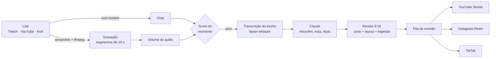

# autocortes

Assiste a lives, encontra os momentos-chave, corta, reenquadra em 9:16, legenda e publica ao mesmo tempo no **YouTube Shorts**, **Instagram Reels** e **TikTok**.

> Nome provisório. Meta: **lançamento do GTA 6 (19/11/2026)**, com várias lives ao mesmo tempo. Status: o modo live (`autocortes watch`) grava, detecta picos, julga com o Claude e entrega shorts numa fila de revisão; a publicação ainda é manual.

## Como funciona



1. **Captura**: o `streamlink` puxa cada live e o `ffmpeg` grava em segmentos de 10 s, sem reencode. O chat da Twitch é lido em paralelo, com horário.
2. **Detecção**: sinais baratos rodam o tempo todo: volume de mensagens no chat, emotes de risada/hype (`KEKW`, `kkkk`, "clipa") e picos de volume. Quando disparam, o trecho em volta é transcrito e o Claude decide se vale um corte, onde começa e termina (em frases completas) e escreve título, descrição e hashtags.
3. **Render**: uma passada de `ffmpeg` por short: corta, reenquadra para 1080×1920 (fundo desfocado, recorte central, facecam em cima + gameplay embaixo, ou recorte que segue o rosto), normaliza o volume e queima a legenda palavra a palavra.
4. **Revisão**: os shorts caem em `data/fila/` com o texto do post pronto; você assiste, aprova e posta.
5. **Publicação**: por enquanto manual. Depois, as três plataformas em paralelo.

Desenho técnico: [docs/ARQUITETURA.md](docs/ARQUITETURA.md). O que cada plataforma exige (conta, app, auditoria, limites): [docs/PLATAFORMAS.md](docs/PLATAFORMAS.md). **O TikTok só deixa postar público pela API depois de auditar o app, o que leva semanas; no lançamento, a postagem lá é manual.**

## Roadmap

| Fase | Entrega | Como validar |
|---|---|---|
| 0 — Fundação ✅ | estrutura, config, CLI, `doctor` | `autocortes doctor` |
| 1 — Trecho → short ✅ | dado um vídeo e um intervalo, gera o short 9:16 legendado | `autocortes render` |
| 2 — Live ✅ (base) | várias lives ao mesmo tempo: gravação, chat da Twitch, picos, juiz do Claude, fila de revisão | `autocortes watch` numa live real |
| 3 — Ensaio até 19/11 | rodar em lives de GTA V/RP, calibrar limites e o prompt do juiz, medir a cota do Claude | cortes bons na fila |
| 4 — Publicação | YouTube automático; Instagram e TikTok depois do lançamento | posts privados primeiro |
| 5 — Painel | fila de revisão no navegador, agenda, métricas por post | — |

A análise de VODs gravados, que vinha antes da live no plano original, ficou para depois: com o lançamento do GTA 6 marcado, o modo live passou na frente.

## Requisitos

- Python 3.11+ (o `.venv` deste projeto usa 3.12)
- [ffmpeg](https://www.gyan.dev/ffmpeg/builds/) no PATH, build "full" (precisa de libass para as legendas): `winget install Gyan.FFmpeg`
- [Claude Code](https://code.claude.com) instalado (a CLI `claude`), para o juiz usar a sua assinatura
- Opcional: GPU NVIDIA para transcrever e renderizar mais rápido

## Instalação

```powershell
py -3.12 -m venv .venv
.venv\Scripts\python -m pip install -e ".[dev,render,detect,ingest]"
copy .env.example .env
.venv\Scripts\autocortes doctor
```

Para o juiz usar a sua assinatura do Claude, rode `claude setup-token` num terminal, autorize com a conta que vai usar e cole o token no `.env` como `CLAUDE_CODE_OAUTH_TOKEN`. Com o venv ativado (`.venv\Scripts\Activate.ps1`), basta chamar `autocortes`.

## Uso

### Lives

```powershell
autocortes watch twitch.tv/canal1 twitch.tv/canal2 twitch.tv/canal3
autocortes queue
```

- `watch` grava cada live, lê o chat e procura picos de reação; o Claude julga cada pico, e o short sai em `data/fila/` com um `.txt` de título, descrição e hashtags prontos para colar. `queue` lista o que já está pronto.
- Pode começar antes da live: ele espera o canal entrar no ar.
- Sem o Claude disponível (sem login ou sem cota), os picos viram short do mesmo jeito, só pelos sinais, marcados como "sem juiz". `--no-judge` força esse modo.
- `--minutes 30` para sozinho depois de 30 min, bom para ensaio. Ctrl+C para na hora.
- Chat só da Twitch por enquanto; em lives do YouTube ou do Kick, os picos saem só pelo áudio.

### Um trecho de vídeo

```powershell
autocortes render live.mp4 --start 12:30 --end 13:10                  # layout do config.yaml (blur)
autocortes render live.mp4 -s 12:30 -e 13:10 --layout face            # recorte que segue o rosto
autocortes render live.mp4 -s 12:30 -e 13:10 --layout split --facecam 1496,40,384,216
```

O short sai em `data/shorts/`: o `.mp4` em 1080×1920 e, ao lado, a legenda `.ass`.

| Layout | Para quê |
|---|---|
| `blur` | qualquer vídeo: ele inteiro no meio, com o fundo desfocado |
| `center` | ação no meio da tela |
| `split` | gameplay com webcam: webcam em cima, jogo embaixo (`--facecam x,y,largura,altura` em pixels do vídeo original) |
| `face` | podcast e just chatting: o recorte acompanha o rosto |

Na primeira transcrição o Whisper baixa o modelo (~1,6 GB); no primeiro `face`, o detector de rosto (~230 KB). `--no-captions` pula a legenda.

## Estrutura

```
autocortes/
├── config.yaml          parâmetros do pipeline (versionado)
├── .env.example         modelo dos segredos (copie para .env, fica fora do git)
├── docs/                arquitetura e requisitos das plataformas
├── src/autocortes/
│   ├── cli.py           comandos
│   ├── live.py          modo live: canais, juiz, render e fila
│   ├── config.py        leitura do config.yaml e do .env
│   ├── doctor.py        checagem do ambiente
│   ├── ffmpeg.py        acha e roda ffmpeg/ffprobe
│   ├── models.py        tipos que passam de uma etapa para outra
│   ├── assets/fonts/    fonte da legenda (Montserrat ExtraBold, licença OFL)
│   ├── ingest/          gravação em segmentos e chat da Twitch
│   ├── detect/          sinais, picos e o juiz (Claude via `claude -p`)
│   ├── render/          corte, 9:16 e legendas
│   └── publish/         YouTube, Instagram e TikTok     (fase 4)
├── tests/
└── data/                gravações, fila e modelos (gerado, fora do git)
```

## Direitos autorais

Cortar a live de outra pessoa sem autorização rende strike e pode derrubar o canal. Use em lives suas ou de criadores que liberam cortes (muitos têm programa oficial), sempre dando crédito.
