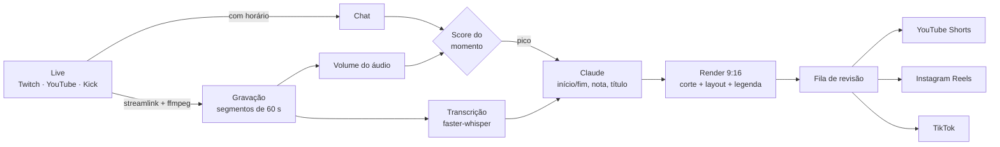

# autocortes

Assiste a lives, encontra os momentos-chave, corta, reenquadra em 9:16, legenda e publica ao mesmo tempo no **YouTube Shorts**, **Instagram Reels** e **TikTok**.

> Nome provisório. Status: **fase 1 pronta**: `autocortes render` transforma um trecho de vídeo num short 9:16 legendado.

## Como funciona



1. **Captura** — o `streamlink` puxa a live e o `ffmpeg` grava em segmentos de 60 s, sem reencode. O chat é gravado em paralelo, com horário.
2. **Detecção** — sinais baratos rodam o tempo todo: velocidade do chat, emotes de risada/hype (`KEKW`, `kkkk`, "clipa"), picos de volume, clipes criados pelos viewers. Quando disparam, o Claude lê a transcrição em volta do pico e decide se vale um corte, onde começa e termina (em frases completas) e escreve título, descrição e hashtags.
3. **Render** — uma passada de `ffmpeg` por short: corta, reenquadra para 1080×1920 (fundo desfocado, recorte central, facecam em cima + gameplay embaixo, ou recorte que segue o rosto), normaliza o volume e queima a legenda palavra a palavra.
4. **Revisão** — você aprova, edita o título ou descarta. Quando a detecção estiver confiável, dá para ligar a publicação automática.
5. **Publicação** — sobe nas três plataformas em paralelo e guarda o link de cada post.

Desenho técnico: [docs/ARQUITETURA.md](docs/ARQUITETURA.md). O que cada plataforma exige (conta, app, auditoria, limites): [docs/PLATAFORMAS.md](docs/PLATAFORMAS.md) — **o TikTok só deixa postar público depois de auditar o app, então vale começar esse processo cedo.**

## Roadmap

| Fase | Entrega | Extra a instalar | Como validar |
|---|---|---|---|
| 0 — Fundação ✅ | estrutura, config, CLI, `doctor` | — | `autocortes doctor` |
| 1 — VOD → short ✅ | dado um vídeo e um intervalo, gera o short 9:16 legendado | `render` | `autocortes render` (veja Uso) |
| 2 — Detecção em VOD | acha os momentos num VOD gravado (com o chat dele) | `detect`, `ingest` | comparar com os momentos que você marcaria na mão |
| 3 — Live | gravação contínua + chat + detecção em janela deslizante | — | rodar numa live e ver a fila encher |
| 4 — Publicação | YouTube → Instagram → TikTok, em paralelo | `publish` | posts privados/rascunho primeiro |
| 5 — Painel | fila de revisão no navegador, agenda, métricas por post | — | — |

A ordem é proposital: corte, 9:16 e legenda (fase 1) e a detecção (fase 2) dá para desenvolver e calibrar em VODs, sem esperar live e sem depender de API de rede social.

## Requisitos

- Python 3.11+ (o `.venv` deste projeto usa 3.12)
- [ffmpeg](https://www.gyan.dev/ffmpeg/builds/) no PATH, build "full" (precisa de libass para as legendas): `winget install Gyan.FFmpeg`
- Opcional: GPU NVIDIA para transcrever e renderizar mais rápido

## Instalação

```powershell
py -3.12 -m venv .venv
.venv\Scripts\python -m pip install -e ".[dev,render]"
copy .env.example .env
.venv\Scripts\autocortes doctor
```

Cada fase adiciona o seu extra (tabela acima). Com o venv ativado (`.venv\Scripts\Activate.ps1`), basta chamar `autocortes`.

## Uso

```powershell
autocortes render live.mp4 --start 12:30 --end 13:10                  # layout do config.yaml (blur)
autocortes render live.mp4 -s 12:30 -e 13:10 --layout face            # recorte que segue o rosto
autocortes render live.mp4 -s 12:30 -e 13:10 --layout split --facecam 1496,40,384,216
```

O short sai em `data/shorts/`: o `.mp4` em 1080×1920 e, ao lado, a legenda `.ass`.

| Layout | Para quê |
|---|---|
| `blur` | qualquer vídeo: ele inteiro no meio, com o fundo desfocado |
| `center` | ação no meio da tela |
| `split` | gameplay com webcam: webcam em cima, jogo embaixo (`--facecam x,y,largura,altura` em pixels do vídeo original) |
| `face` | podcast e just chatting: o recorte acompanha o rosto |

Na primeira transcrição o Whisper baixa o modelo (~1,6 GB); no primeiro `face`, o detector de rosto (~230 KB). `--no-captions` pula a legenda.

## Estrutura

```
autocortes/
├── config.yaml          parâmetros do pipeline (versionado)
├── .env.example         modelo dos segredos (copie para .env, fica fora do git)
├── docs/                arquitetura e requisitos das plataformas
├── src/autocortes/
│   ├── cli.py           comandos
│   ├── config.py        leitura do config.yaml e do .env
│   ├── doctor.py        checagem do ambiente
│   ├── ffmpeg.py        acha e roda ffmpeg/ffprobe
│   ├── models.py        tipos que passam de uma etapa para outra
│   ├── assets/fonts/    fonte da legenda (Montserrat ExtraBold, licença OFL)
│   ├── render/          corte, 9:16 e legendas          (fase 1)
│   ├── detect/          sinais, score e Claude          (fase 2)
│   ├── ingest/          captura da live e do chat       (fases 2-3)
│   └── publish/         YouTube, Instagram e TikTok     (fase 4)
├── tests/
└── data/                gravações, cortes e banco (gerado, fora do git)
```

## Direitos autorais

Cortar a live de outra pessoa sem autorização rende strike e pode derrubar o canal. Use em lives suas ou de criadores que liberam cortes (muitos têm programa oficial), sempre dando crédito.
